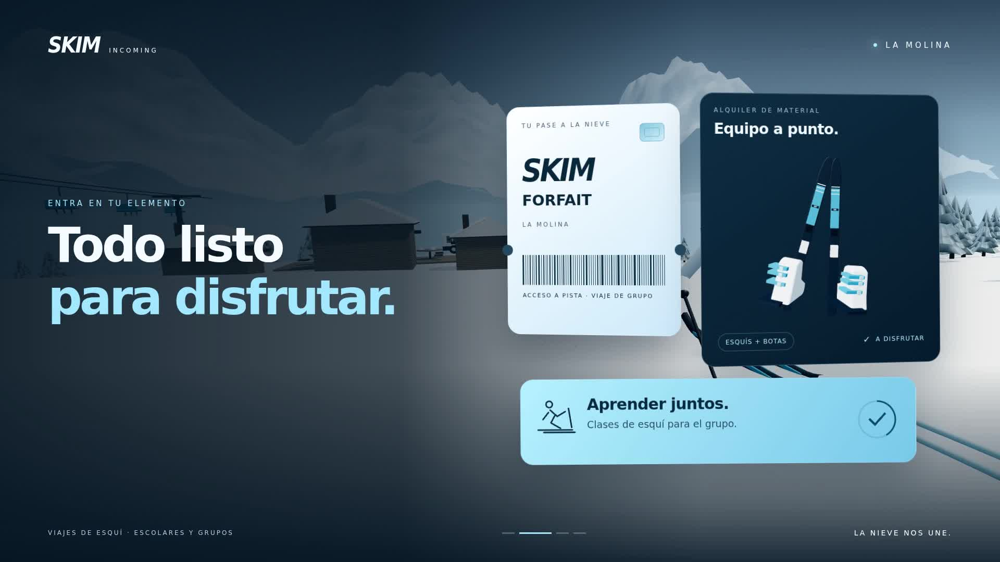
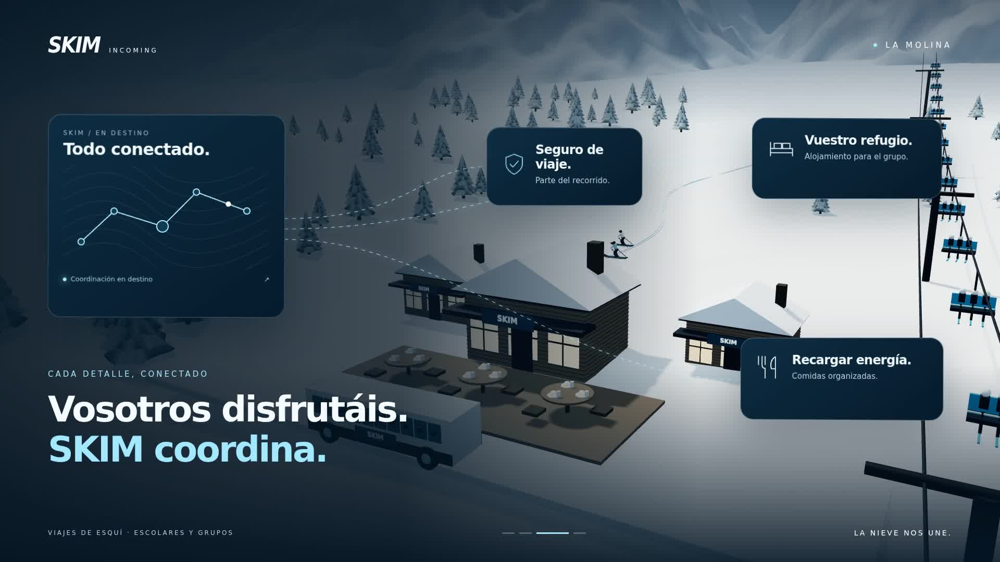

# SKIM Incoming · V2 «Todo conectado»

Nueva versión con **nueve interfaces animadas**, más cambios de cámara y una **composición musical original nueva**. Vídeo de 15 segundos, 1920 × 1080, 60 fps. Imagen, animación y sonido construidos íntegramente mediante código.

## Ver y descargar la V2

- [**SKIM_V2.mp4**](SKIM_V2.mp4). Abre el archivo y pulsa **Download raw file** (flecha hacia abajo). Si aparece **View raw**, haz clic derecho y elige **Guardar enlace como…**.
- [**Fuentes, música y evidencias de revisión — ZIP V2**](SKIM_fuentes_V2.zip).
- [**Decisiones e iteraciones de V2**](film-v2/DECISIONES.md).

Los archivos `SKIM.mp4` y `SKIM_fuentes.zip` también apuntan a esta última entrega. La primera versión sigue disponible en el historial y su código está en `film/`. El código de la revisión está en [`film-v2/`](film-v2/), con [instrucciones de reproducción](film-v2/README.md).

## Fotogramas del MP4 V2

## Alcance

La montaña es una interpretación artística de La Molina. Los paneles son interfaces conceptuales de campaña; no representan reservas o pases reales. No se ha usado stock, música externa, muestras sonoras ni modelos generativos. La revisión visual se realiza por fotogramas exportados; el audio se comprueba técnicamente, sin escucha directa disponible. Los resultados medidos y el tiempo real están en DECISIONES.md.
