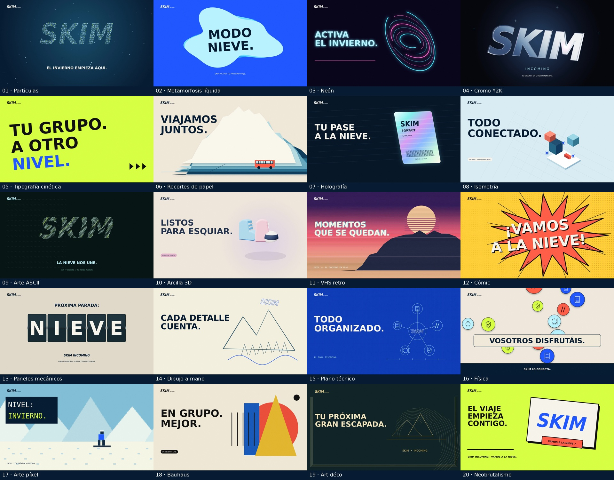

# SKIM Incoming · V3 · 20 estilos animados

Campaña nueva de **27 segundos, 1920 × 1080 y 60 fps**, con los veinte estilos enumerados en la referencia y música electrónica original a 150 BPM. La V3 sustituye el guion anterior por una sucesión de interpretaciones gráficas para promocionar los viajes de esquí de SKIM.

## Ver y descargar

- [**Vídeo V3 — SKIM_V3.mp4**](SKIM_V3.mp4). Abre el archivo y pulsa **Download raw file**, la flecha hacia abajo. Si aparece **View raw**, haz clic derecho y elige **Guardar enlace como…**.
- [**Fuentes, banda sonora y evidencias — ZIP V3**](SKIM_fuentes_V3.zip).
- [**Decisiones, iteraciones, verificación y tiempo real**](film-v3/DECISIONES.md).
- [**Instrucciones para reproducir el render**](film-v3/README.md).

`SKIM.mp4` y `SKIM_fuentes.zip` contienen también esta entrega. Las versiones anteriores permanecen en `film/`, `film-v2/`, `SKIM_V2.mp4` y `SKIM_fuentes_V2.zip`.

## Los veinte estilos en el MP4

Partículas, líquido, neón, cromo Y2K, tipografía cinética, papel, holografía, isometría, ASCII, arcilla 3D, VHS, cómic, paneles mecánicos, dibujo a mano, plano técnico, física, píxel, Bauhaus, art déco y neobrutalismo. Cierre legible de SKIM Incoming durante tres segundos.

Todo se construye con código: Canvas 2D, Three.js y síntesis de audio. No se usan stock, samples ni modelos generativos. La referencia es una imagen estática; se interpretan sus estilos. Revisión visual por fotogramas de todo el MP4 y comprobaciones técnicas del audio; no hubo escucha directa disponible.
